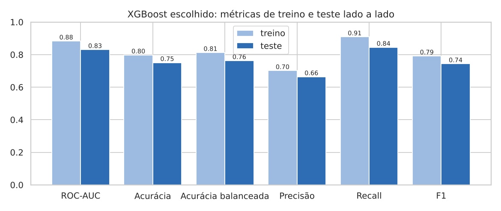
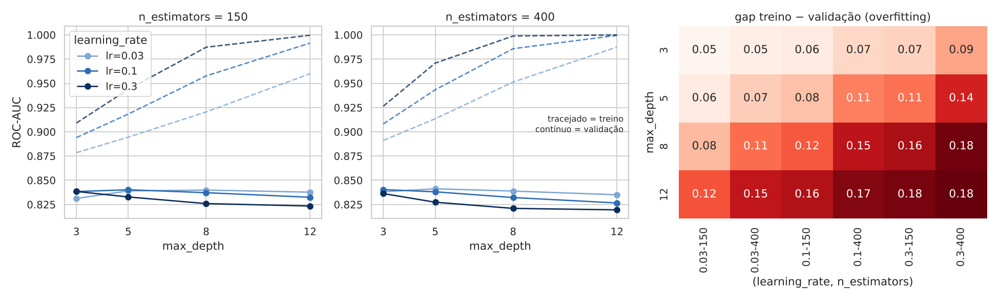
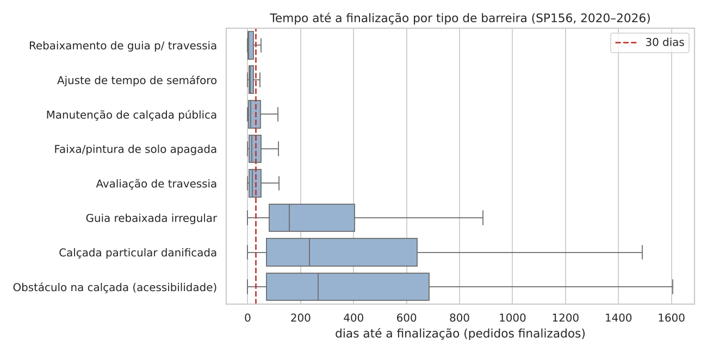

# Relatório de Machine Learning · AJA

**Global Solution 2026.2 · CitizenTech · Inteligência Artificial & Machine Learning**
Notebook executado: [`notebook_sp156_tempo_resposta.ipynb`](notebook_sp156_tempo_resposta.ipynb)

## 1. Problema

O contexto do AJA está no [README principal](../README.md). Aqui o foco é quem já abriu um pedido de
reparo no SP156 e não sabe quanto tempo vai esperar.

**Pergunta de ML:** no momento em que um pedido sobre barreira para pedestres é aberto no SP156, ele
será finalizado em até 30 dias?

É uma classificação binária supervisionada. A resposta permite ao AJA mostrar uma expectativa
honesta ao cidadão e iniciar o acompanhamento ativo quando a chance de resposta rápida é baixa.

## 2. Dados reais e públicos

| Item | Valor |
|---|---|
| Fonte | Portal de Dados Abertos da Prefeitura de São Paulo, conjunto “Dados do SP156 – Solicitações” |
| Link | http://dados.prefeitura.sp.gov.br/dataset/dados-do-sp156 |
| Período | pedidos abertos de 01/01/2020 a 30/09/2026 (25 arquivos trimestrais) |
| Acesso | arquivos baixados em 13/11/2026; status refletem a extração feita pela Prefeitura (jul. a out. de 2026; um arquivo em nov. de 2025) |
| Recorte | 10 serviços de barreiras para pedestres; **120.248 pedidos** |

Cada arquivo trimestral tem de 300 mil a 1,1 milhão de pedidos de todos os temas. O script
[`dados/extrair_sp156.py`](dados/extrair_sp156.py) localiza as colunas pelo nome, porque ordem,
separador, codificação e formato de data mudam entre trimestres. Ficaram de fora o 2º trimestre de
2021 (publicado só em XLSX) e o 2º trimestre de 2024 (sem a coluna de serviço). Detalhes em
[`dados/README.md`](dados/README.md).

A base pública não traz nome nem documento do solicitante. Mesmo assim, descartamos logradouro,
número e CEP e arredondamos as coordenadas para cerca de 100 m.

## 3. Preparação e divisão treino/teste

**Alvo.** `y = 1` quando o pedido foi finalizado em até 30 dias. `y = 0` quando foi finalizado depois
disso ou continuava aberto mais de 30 dias após a abertura. Pedidos abertos há menos de 30 dias na data
de extração (888) têm rótulo desconhecido e foram removidos, o que evita o viés de censura.

**Limpeza.**
- Removemos os pedidos cancelados pelo cidadão.
- Removemos “Sugerir construção de calçadas”, que é fechado no mesmo dia por ser só uma sugestão, e
  “Manutenção de semáforos”, com apenas 19 casos.
- Padronizamos os nomes de subprefeitura, que variam entre anos, e preenchemos as vazias a partir do
  distrito.
- Base final: **115.133 pedidos, 42,5% positivos**.

**Variáveis.** Usamos apenas o que se sabe na abertura do pedido:
- tipo de serviço, canal e subprefeitura (one-hot encoding);
- latitude e longitude aproximadas;
- mês e dia da semana;
- `carga_30d`, a quantidade de pedidos do mesmo serviço na mesma subprefeitura nos 30 dias
  anteriores (fila de trabalho).

O campo “órgão” ficou de fora porque mostra o órgão na data de extração, depois de eventuais
transferências, o que seria vazamento de informação. No total são 51 colunas.

**Divisão temporal.**

| Conjunto | Período de abertura | Pedidos | Positivos |
|---|---|---|---|
| Treino | jan/2020 a dez/2024 | 71.794 | 42,3% |
| Teste | jan/2025 a set/2026 | 43.339 | 42,7% |

Separar por data simula o uso real: o modelo aprende com o passado e é avaliado num período que
nunca viu. Isso importa porque a taxa muda com o tempo:
- o volume dobrou, de cerca de 2.900 pedidos por trimestre em 2020 para 6.000 em 2025;
- a taxa de resposta em 30 dias subiu de 33% para 46%, mas sobretudo porque a **composição** mudou: a
  parcela de pedidos dos serviços lentos caiu de 48% para 36%;
- dentro de cada grupo, a taxa variou pouco (rápidos entre 60% e 73%, lentos entre 5% e 10%);
- em 2026 (jan. a set.) a taxa caiu para 39%.

## 4. Modelo e treino

**Por que XGBoost.** Os dados são tabulares, com categorias e números, e árvores com *boosting* são
o padrão mais forte nesse formato. Elas capturam interações (o mesmo serviço demora mais em certas
regiões) e têm hiperparâmetros claros de complexidade, o que permite estudar o overfitting. As outras
opções não se encaixam tão bem: LSTM serve para séries temporais, KMeans não é supervisionado e MLP
costuma perder para árvores em tabelas desse porte.

**Baseline.** Prever a taxa histórica de resposta em até 30 dias de cada serviço, calculada no treino.

**Busca de hiperparâmetros.** Testamos 3 hiperparâmetros em 4 × 3 × 2 = **24 combinações**:
- `max_depth`: 3, 5, 8, 12;
- `learning_rate`: 0,03; 0,1; 0,3;
- `n_estimators`: 150, 400.

Cada combinação passou por validação cruzada **temporal** (`TimeSeriesSplit`, 4 dobras) **apenas no
treino**, com ROC-AUC como métrica de escolha. A tabela completa das 24 combinações está na seção 5
do notebook.

| Posição | max_depth | learning_rate | n_estimators | AUC treino (CV) | AUC validação (CV) | Gap |
|---|---|---|---|---|---|---|
| 1 | 5 | 0,03 | 400 | 0,913 | **0,841** | 0,072 |
| 2 | 3 | 0,1 | 400 | 0,908 | 0,840 | 0,068 |
| 22 | 12 | 0,3 | 150 | 1,000 | 0,823 | 0,176 |
| 24 | 12 | 0,3 | 400 | 1,000 | 0,819 | 0,181 |

## 5. Resultados em treino e teste

Limiar de decisão 0,5. O teste foi usado uma única vez, depois da escolha do modelo.

| Modelo | Conjunto | ROC-AUC | Acurácia | Acur. balanceada | Precisão | Recall | F1 |
|---|---|---|---|---|---|---|---|
| Baseline (taxa por serviço) | Treino | 0,827 | 0,778 | 0,799 | 0,670 | 0,937 | 0,781 |
| | Teste | 0,794 | 0,746 | 0,769 | 0,640 | 0,928 | 0,758 |
| **XGBoost escolhido** | Treino | 0,883 | 0,798 | 0,813 | 0,701 | 0,909 | 0,792 |
| | Teste | **0,831** | 0,751 | 0,763 | 0,664 | 0,845 | 0,743 |
| XGBoost mais complexo | Treino | 1,000 | 0,995 | 0,995 | 0,994 | 0,995 | 0,994 |
| | Teste | 0,801 | 0,722 | 0,719 | 0,667 | 0,696 | 0,682 |

**Overfitting: quando o modelo decora em vez de aprender.** Um modelo com overfitting memoriza os
detalhes dos dados de treino e não consegue generalizar: vai muito bem no que já viu e mal em dados novos.
- **Na busca:** quanto mais profundas as árvores (`max_depth`) e maior o passo de aprendizado
  (`learning_rate`), mais o modelo acerta no treino, chegando a uma AUC de quase 1. Nos meses que ele
  não viu, porém, a nota trava em torno de 0,84 e depois cai. A distância entre as duas notas (o gap)
  cresce de 0,05 para 0,18.
- **O caso extremo:** o modelo mais complexo da grade tem AUC de 1,000 no treino e 0,801 no teste, pior
  até que o baseline. Ele decorou.
- **O modelo escolhido** (o XGBoost da busca: `max_depth` 5, `learning_rate` 0,03 e 400 árvores) perde
  só 0,05 do treino para o teste. Parte dessa perda nem é overfitting: a taxa de resposta da Prefeitura
  mudou de um ano para o outro, e o teste cobra justamente esse período novo.

**O que os números dizem, sem exagero.**
- **Onde o modelo ganha:** ele ordena melhor quais pedidos têm mais chance de sair rápido. A AUC no teste
  é 0,831, contra 0,794 do baseline. A precisão também é maior: quando ele diz “sai em 30 dias”, acerta
  mais vezes.
- **Onde empata:** quando a chance vira um “sim ou não” (corte em 0,5), a acurácia fica praticamente
  igual à do baseline e o F1 fica um pouco abaixo. Isso acontece porque o baseline diz “sim” com mais
  frequência e, por isso, encontra mais pedidos rápidos.
- **De onde vem a previsão:** o tipo de serviço responde por cerca de 80% do que o modelo aprendeu. A
  subprefeitura e a localização fazem o ajuste fino dentro de cada serviço, e é esse ajuste que coloca o
  modelo à frente do baseline.

## 6. Conclusão para o cidadão

- **As barreiras que mais afetam pessoas com deficiência visual são as mais lentas.** Entre 2020 e
  2026, os pedidos de manutenção de calçada pública tiveram mediana de 12 dias até a finalização, e
  61% foram finalizados em até 30 dias. Nos pedidos de **“obstáculo na calçada” (acessibilidade)**, a
  mediana foi de **266 dias**, e só 7% foram finalizados em até 30 dias. Denúncias de calçada
  particular danificada seguem o mesmo padrão (234 dias, 7%).
- **No Parque Doroteia (Subprefeitura Cidade Ademar),** o modelo previu para 2025–2026 uma chance de
  2% de resposta em 30 dias para obstáculo na calçada, e a taxa real foi de 3%. Para ajuste de tempo
  de semáforo, a previsão foi de 87%, e a taxa real, de 96%. O modelo superestimou a avaliação de
  travessia nessa região (60% previsto contra 34% real, fora do intervalo de confiança de 95%), o que
  mostra que o padrão local pode fugir da média da cidade. Em serviços com poucos pedidos na região
  (6 a 31 casos em 21 meses) o intervalo é largo demais para concluir algo, e o AJA deve mostrar a
  previsão junto com o número de casos que a sustentam.
- **Como o AJA usa isso:**
  - ao registrar uma barreira, a pessoa vê uma expectativa realista de prazo;
  - quando a chance é baixa, o tópico já nasce com acompanhamento ativo: lembretes, convite à
    comunidade para confirmar e reforçar evidências, e inclusão no dossiê para a subprefeitura;
  - o cidadão deixa de carregar sozinho o trabalho de cobrar.
- **Limites:**
  - o modelo prevê quando o **protocolo é encerrado**, não se a barreira foi removida, e por isso o
    AJA mantém a confirmação pela comunidade e a avaliação de antes e depois;
  - a previsão nunca deve desestimular um registro: chance baixa é argumento para pressionar, não
    para desistir;
  - próximos passos: modelar o tempo em dias (análise de sobrevivência) e incluir dados do Censo 2022
    sobre calçadas e rampas no entorno.
